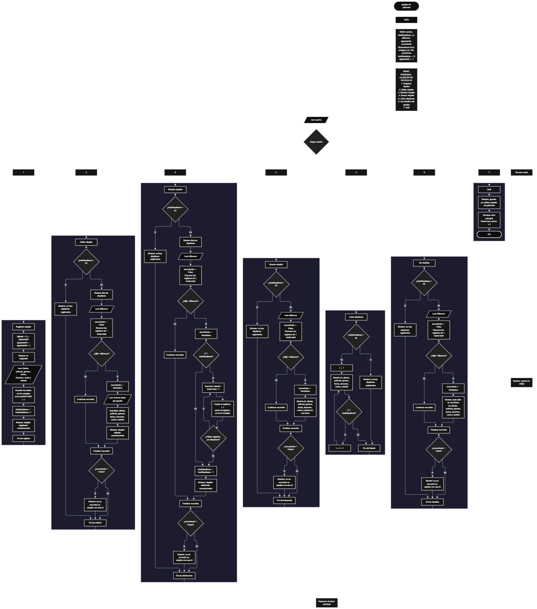

Este proyecto, llamado <b>alquiler de películas</b>, fue desarrollado en <b>pseint</b> como un ejercicio práctico para fortalecer la lógica de programación mediante la creación de un sistema de gestión de alquileres desde la consola. El programa cuenta con un menú principal de siete opciones que permite <b>registrar, editar, eliminar, buscar, listar y consultar los detalles</b> de los alquileres registrados. Cada alquiler almacena datos como el cliente, la película, el género, la fecha, la duración, el costo y el estado, utilizando arreglos con una capacidad de <b>100 posiciones durante la ejecución</b>. Durante su desarrollo se aplicaron conceptos fundamentales de programación, como variables, arreglos, estructuras condicionales, ciclos repetitivos y estructuras de selección, además de procesos para buscar, modificar, eliminar y organizar registros. Este proyecto permite poner en práctica los conocimientos adquiridos en PSeInt y sirve como base para desarrollar sistemas de gestión más avanzados utilizando otros lenguajes y tecnologías.

<h2 align="center">⚙️ Funcionamiento del menú principal</h2>

### ➕ Registrar alquiler

La opción <b>1) registrar alquiler</b> permite agregar un nuevo alquiler al sistema. El programa asigna automáticamente un <b>id</b> tomado de la variable <b>siguienteID</b>, que luego aumenta en uno, y lo muestra al usuario con el mensaje <b>"id asignado"</b>. Después solicita el <b>nombre del cliente, el nombre de la película, el género, la fecha del alquiler, la duración, el costo y el estado</b>. Todos los datos se almacenan en la posición <b>totalAlquileres + 1</b> de sus respectivos arreglos. Finalmente, la variable <b>totalAlquileres</b> aumenta en uno y se muestra el mensaje <b>"alquiler registrado correctamente."</b>.

### ✏️ Editar alquiler

La opción <b>2) editar alquiler</b> permite modificar la información de un alquiler registrado. Primero, el programa comprueba si existen alquileres almacenados mediante la variable <b>totalAlquileres</b>. Si no hay registros, muestra el mensaje <b>"no hay alquileres registrados."</b>. En caso contrario, presenta una lista con el id, cliente, película, género, fecha, duración, costo y estado de cada alquiler. Después, solicita el <b>id</b> del alquiler que se desea editar y recorre los arreglos con un ciclo <b>para</b> comparando <b>id[i] = idBuscar</b>. Si encuentra una coincidencia, solicita el nuevo cliente, película, género, fecha, duración, costo y estado, actualizando directamente los valores de los arreglos, y muestra el mensaje <b>"alquiler editado correctamente."</b>. Si no existe un alquiler con ese id, muestra el mensaje <b>"no se encontró un alquiler con ese id."</b>.

### 🗑️ Eliminar alquiler

La opción <b>3) eliminar alquiler</b> permite eliminar un alquiler registrado mediante su id. Antes de comenzar, el programa comprueba que existan alquileres almacenados. Si no hay registros, muestra el mensaje <b>"no hay alquileres registrados."</b>. Si hay registros disponibles, presenta la lista completa y solicita el id del alquiler que se desea eliminar. Cuando encuentra la coincidencia, y si el alquiler no es el último de la lista, utiliza un ciclo <b>para</b> controlado por la variable <b>j</b>, que va desde la posición encontrada hasta <b>totalAlquileres - 1</b> y copia en cada posición los datos de la siguiente en los ocho arreglos. Posteriormente, disminuye la variable <b>totalAlquileres</b> en uno y muestra el mensaje <b>"alquiler eliminado correctamente."</b>. Si el id no existe, muestra el mensaje <b>"no se encontró un alquiler con ese id."</b>.

### 🔎 Buscar alquiler

La opción <b>4) buscar alquiler</b> permite localizar un alquiler mediante su id. Primero, el programa comprueba si existen alquileres registrados. Si no hay registros, muestra el mensaje <b>"no hay alquileres registrados."</b>. En caso contrario, inicializa la variable lógica <b>encontrado</b> con el valor <b>falso</b> y solicita el id que se desea buscar. A continuación, utiliza un ciclo <b>para</b> para recorrer el arreglo <b>id</b> y compararlo con el valor introducido. Cuando encuentra una coincidencia, cambia la variable <b>encontrado</b> a <b>verdadero</b> y muestra en una sola línea los datos del alquiler. Si finaliza el recorrido sin coincidencias, presenta el mensaje <b>"no se encontró un alquiler con ese id."</b>.

### 📋 Listar alquileres

La opción <b>5) listar alquileres</b> permite visualizar todos los alquileres registrados actualmente. Antes de mostrar la información, el programa comprueba si la variable <b>totalAlquileres</b> es igual a cero. Si no existen registros, presenta el mensaje <b>"no hay alquileres registrados."</b>. Si hay alquileres disponibles, utiliza un ciclo <b>para</b> que recorre los arreglos desde la primera posición hasta el total de alquileres registrados, mostrando en cada línea el id, cliente, película, género, fecha, duración, costo y estado. Esta función facilita consultar los registros existentes sin necesidad de buscar cada alquiler individualmente.

### 📄 Ver detalles del alquiler

La opción <b>6) ver detalles del alquiler</b> permite consultar todos los datos de un alquiler específico. Primero, el programa comprueba si existen alquileres registrados. Si no hay registros, muestra el mensaje <b>"no hay alquileres registrados."</b>. En caso contrario, solicita el id del alquiler que se desea consultar y lo busca en el arreglo <b>id</b>. Si lo encuentra, muestra cada dato en una línea independiente: <b>id, cliente, película, género, fecha, duración, costo y estado</b>. Si el id no corresponde a ningún alquiler registrado, presenta el mensaje <b>"no se encontró un alquiler con ese id."</b>. La diferencia con la opción de buscar es el formato de presentación, que en este caso es más detallado.

### 🚪 Salir del menú principal

La opción <b>7) salir</b> finaliza la ejecución del programa y muestra el mensaje <b>"gracias por utilizar alquiler de peliculas."</b>. El menú principal se encuentra dentro de una estructura repetitiva <b>repetir ... hasta que opcion = 7</b>, que mantiene el programa en funcionamiento mientras se realizan las operaciones disponibles. La condición del ciclo coincide con la opción de salida del menú, por lo que al seleccionar la opción 7 el programa termina correctamente.

<h2 align="center">🧠 Temas aplicados en el proyecto</h2>

### 📦 Variables

En este proyecto se utilizan variables para guardar la opción seleccionada en el menú, controlar la cantidad de alquileres registrados, generar identificadores únicos, recorrer los arreglos, almacenar el id que se desea buscar y comprobar si se encontró una coincidencia. Cada variable cumple una función específica dentro de las operaciones de gestión de alquileres.

🔢 **opcion:** Almacena la opción seleccionada por el usuario en el menú principal.

📊 **totalAlquileres:** Almacena la cantidad actual de alquileres registrados.

🆔 **siguienteID:** Guarda el próximo id que se asignará, evitando que se repita aunque se eliminen registros.

🔄 **i:** Funciona como contador en los ciclos <b>para</b> que recorren los arreglos.

🔁 **j:** Controla el recorrido utilizado para desplazar los datos durante la eliminación de un alquiler.

🔎 **idBuscar:** Almacena el id introducido por el usuario para editar, eliminar, buscar o consultar.

✅ **encontrado:** Variable lógica que indica si se encontró un alquiler con el id solicitado.

### 🗃️ Arreglos

En este proyecto se utilizan ocho arreglos relacionados con los datos de cada alquiler. Cada arreglo tiene una capacidad de <b>100 posiciones</b> y utiliza el mismo índice para representar la información correspondiente a un mismo alquiler. Por ejemplo, los datos de un alquiler almacenado en la posición <b>1</b> se encuentran distribuidos entre <b>id[1], cliente[1], pelicula[1], genero[1], fecha[1], duracion[1], costo[1] y estado[1]</b>. Esta organización, conocida como arreglos paralelos, permite recorrer, buscar, modificar, mostrar y eliminar los alquileres de manera ordenada.

🆔 **id[100]:** Almacena el identificador único de cada alquiler.

👤 **cliente[100]:** Almacena el nombre de cada cliente.

🎬 **pelicula[100]:** Almacena el nombre de la película alquilada.

🎭 **genero[100]:** Almacena el género de la película.

📅 **fecha[100]:** Almacena la fecha del alquiler.

⏱️ **duracion[100]:** Almacena la duración del alquiler.

💰 **costo[100]:** Almacena el costo del alquiler (tipo real).

📌 **estado[100]:** Almacena el estado del alquiler.

### 🔀 Estructuras condicionales

En este proyecto se utilizan las estructuras <b>si</b> y <b>sino</b> para verificar si existen registros antes de realizar determinadas operaciones, determinar si se encontró el id buscado y decidir si es necesario desplazar los datos al eliminar un alquiler. Estas condiciones permiten que el programa responda de manera diferente según el estado del sistema y el resultado de cada operación.

### 🔄 Estructuras repetitivas

En este proyecto se utilizan los ciclos <b>para</b> y <b>repetir ... hasta que</b>. Los ciclos <b>para</b> permiten recorrer los arreglos para mostrar los alquileres, buscar ids y acceder a los registros seleccionados. Durante la eliminación, también se utilizan para desplazar los datos de los alquileres posteriores una posición hacia atrás. Por otro lado, el ciclo <b>repetir ... hasta que</b> mantiene activo el menú principal para que el usuario pueda ejecutar diferentes operaciones antes de salir del programa.

### 🎯 Estructura según

El programa evalúa el valor almacenado en la variable <b>opcion</b> y ejecuta el bloque de instrucciones correspondiente. Cada caso representa una operación específica del sistema: <b>registrar, editar, eliminar, buscar, listar, ver detalles o salir</b>. También se utiliza el bloque <b>de otro modo</b> para mostrar el mensaje <b>"opción no válida."</b> cuando el valor introducido no coincide con ninguna de las opciones definidas.

### 🔢 Dimensionamiento de arreglos

El programa utiliza la instrucción <b>dimension</b> para establecer la capacidad de los arreglos que almacenan la información de los alquileres. Se definieron <b>100 posiciones</b> para cada arreglo. La cantidad de posiciones ocupadas se controla mediante la variable <b>totalAlquileres</b>, por lo que las operaciones recorren únicamente los registros comprendidos entre la primera posición y el total actual de alquileres.

### 🔄 Reorganización de registros

Cuando se selecciona un alquiler para eliminarlo, el programa utiliza un ciclo <b>para</b> que comienza en la posición encontrada y llega hasta <b>totalAlquileres - 1</b>. En cada repetición, los datos de la posición siguiente se copian sobre la posición actual en los ocho arreglos. Después, la variable <b>totalAlquileres</b> disminuye en uno. De esta manera, los alquileres posteriores ocupan las posiciones disponibles sin dejar espacios vacíos entre los registros activos.

### 🆔 Identificadores automáticos

Cada alquiler recibe un id generado automáticamente a partir de la variable <b>siguienteID</b>, que comienza en 1 y aumenta con cada registro. Como este contador nunca disminuye, un id eliminado no se vuelve a asignar a otro alquiler, lo que evita confusiones al buscar, editar o eliminar.

<h2 align="center">¿Cómo se implementaron las operaciones crud en el proyecto?</h2>

Las operaciones <b>crud</b> se implementaron mediante las opciones del menú principal, permitiendo administrar los alquileres registrados. La operación <b>crear</b> corresponde a <b>registrar alquiler</b>, donde se introducen los datos de un nuevo alquiler; <b>leer</b> se realiza mediante las opciones <b>buscar alquiler, listar alquileres y ver detalles del alquiler</b>; <b>actualizar</b> corresponde a <b>editar alquiler</b>, donde se modifican los datos de un alquiler registrado; y <b>eliminar</b> se realiza mediante la opción <b>eliminar alquiler</b>. Estas operaciones utilizan variables, arreglos, condicionales y ciclos para gestionar la información almacenada temporalmente durante la ejecución del programa.

<h2 align="center">Diagrama de flujo del proyecto</h2>

<h2 align="center">🛡️ Validaciones del programa</h2>

### 📭 No existen alquileres registrados

Esta validación se utiliza en las opciones de <b>editar, eliminar, buscar, listar y ver detalles</b>. El programa comprueba si la variable <b>totalAlquileres</b> es igual a <b>0</b> y, si no existen alquileres registrados, muestra el mensaje <b>"no hay alquileres registrados."</b>. Esta comprobación evita continuar con las operaciones que necesitan información almacenada cuando el sistema está vacío.

### ❌ Alquiler no encontrado

Esta validación se utiliza en las opciones de <b>editar, eliminar, buscar y ver detalles</b>. El programa inicializa la variable lógica <b>encontrado</b> con el valor <b>falso</b> y recorre el arreglo <b>id</b> para comparar cada valor con el introducido por el usuario. Cuando encuentra una coincidencia, cambia la variable a <b>verdadero</b> y ejecuta la operación. Si al finalizar el recorrido la variable continúa siendo <b>falso</b>, muestra el mensaje <b>"no se encontró un alquiler con ese id."</b>.

### ⚠️ Opción inválida

La estructura <b>segun</b> incluye el bloque <b>de otro modo</b>, que muestra el mensaje <b>"opción no válida."</b> cuando el usuario introduce un número que no corresponde a ninguna de las opciones definidas en el menú. Como el ciclo solo termina con la opción 7, el menú se vuelve a mostrar hasta que el usuario seleccione una opción correcta.

<h2 align="center">🚀 Posibles mejoras</h2>

Como parte del análisis del proyecto se identificaron mejoras que pueden implementarse en futuras versiones: <b>validar la capacidad máxima de 100 alquileres</b> antes de registrar uno nuevo, <b>evitar que una misma película tenga dos alquileres activos</b>, <b>limitar el género y el estado a opciones definidas</b>, <b>calcular el costo automáticamente</b> a partir de la duración y una tarifa, y <b>reutilizar la búsqueda por id</b> mediante un subproceso para evitar código repetido.

<h2 align="center">🎯 Objetivo del proyecto</h2>

El objetivo principal de este proyecto es fortalecer la <b>lógica de programación</b> mediante el desarrollo de un sistema de gestión de alquiler de películas en <b>pseint</b>. A través de su construcción se busca aplicar los conocimientos adquiridos sobre variables, arreglos, estructuras condicionales, ciclos repetitivos y estructuras de selección, integrándolos para resolver un problema de manera organizada. Además, el proyecto permite comprender cómo registrar, consultar, modificar y eliminar información en una aplicación de consola, estableciendo una base para desarrollar sistemas de gestión más completos con otros lenguajes y tecnologías.

